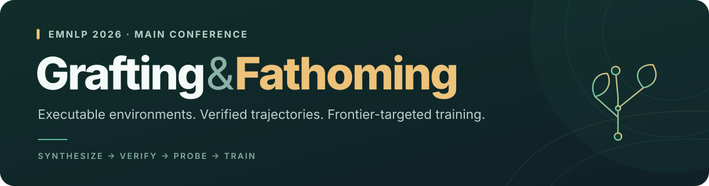
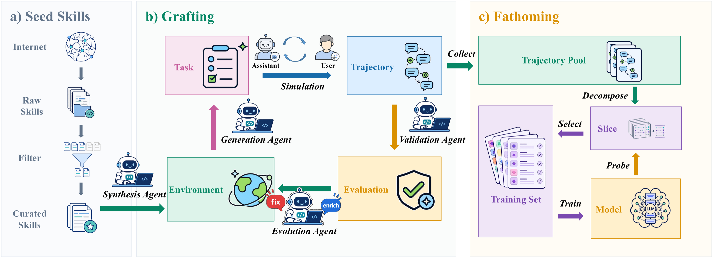

<div align="center">



<h3>From Agent Skills to Executable Environments:<br>Frontier-Targeted Training for Tool-Use LLMs</h3>

<p>
Dawei Zhang · Yubin Huangfu · Kyle Yusong Yao · Boyu Wei · Zongqi Han<br>
Likang Wu · Hongke Zhao · Ming He · Jianping Fan
</p>

<p>
<a href="https://aclanthology.org/2026.emnlp-main.305/"></a>
<a href="https://github.com/zhangdw156/grafting"></a>
<a href="https://huggingface.co/datasets/zhangdw/fathom-12k"></a>
</p>

<p>
<a href="https://aclanthology.org/2026.emnlp-main.305.pdf"><b>Paper PDF ↗</b></a>
&nbsp; · &nbsp;
<a href="#open-resources"><b>Open resources</b></a>
&nbsp; · &nbsp;
<a href="#main-results"><b>Main results</b></a>
&nbsp; · &nbsp;
<a href="#citation"><b>Citation</b></a>
</p>

</div>

> [!TIP]
> **Released · October 28, 2026** — Grafting, Grove-500, Grove-5K, and Fathom-12K are now publicly available. Start with the [implementation and usage guide](https://github.com/zhangdw156/grafting#readme).

## From skills to stronger tool use

**Grafting** turns agent skills into self-contained executable environments and verified multi-turn tool-use trajectories. **Fathoming** probes the target model, selects examples near its current capability boundary, and trains with iterative GRPO.

<p align="center">

</p>

## Open resources

<table>
<tr>
<td width="50%" valign="top">
<h3>🌱 Grafting</h3>
<p><b>The implementation</b></p>
<p>Synthesis, verification, probing, and data selection, plus training reward and BFCLv4 evaluation integrations.</p>
<p><a href="https://github.com/zhangdw156/grafting"><b>Explore code →</b></a> &nbsp; <sub>MIT</sub></p>
</td>
<td width="50%" valign="top">
<h3>🌳 Grove-500</h3>
<p><b>500 executable environments</b></p>
<p>Self-contained environments for the end-to-end experiments and the Fathom-12K trajectory pool.</p>
<p><a href="https://huggingface.co/datasets/zhangdw/grove-500"><b>Get environments →</b></a> &nbsp; <sub>Apache-2.0</sub></p>
</td>
</tr>
<tr>
<td width="50%" valign="top">
<h3>🌲 Grove-5K</h3>
<p><b>5,101 executable environments</b></p>
<p>The larger environment collection for research on synthesis scale, diversity, and tool use.</p>
<p><a href="https://huggingface.co/datasets/zhangdw/grove-5k"><b>Explore the collection →</b></a> &nbsp; <sub>Apache-2.0</sub></p>
</td>
<td width="50%" valign="top">
<h3>🌊 Fathom-12K</h3>
<p><b>12,745 verified trajectories</b></p>
<p>Multi-turn tool-use trajectories from Grove-500, in JSONL for training data preparation and analysis.</p>
<p><a href="https://huggingface.co/datasets/zhangdw/fathom-12k"><b>Download trajectories →</b></a> &nbsp; <sub>Apache-2.0</sub></p>
</td>
</tr>
</table>

Each dataset page includes download instructions and its data format. The [Grafting README](https://github.com/zhangdw156/grafting#readme) covers installation, pipeline commands, probing, and the released training and evaluation integrations.

## Main results

Two rounds of Fathoming starting from **Qwen3-4B-Instruct-2507** produce **Fathom-4B**. The paper reports accuracy (%) below; gains are percentage points.

| Model | BFCLv4<br><sub>Multi-turn</sub> | ComplexFuncBench<br><sub>Per-call</sub> |
|---|---:|---:|
| Base | 22.0 | 49.6 |
| **Fathom-4B** | **39.7** | **61.6** |
| **Gain** | **+17.7** | **+12.0** |

See the [published paper](https://aclanthology.org/2026.emnlp-main.305/) for evaluation settings, ablations, and limitations.

## Citation

If you use this work, please cite the published EMNLP paper.

<details>
<summary><b>BibTeX · EMNLP 2026</b></summary>

```bibtex
@inproceedings{zhang-etal-2026-agent-skills,
    title = "From Agent Skills to Executable Environments: Frontier-Targeted Training for Tool-Use {LLM}s",
    author = "Zhang, Dawei  and
      Huangfu, Yubin  and
      Yao, Kyle Yusong  and
      Wei, Boyu  and
      Han, Zongqi  and
      Wu, Likang  and
      Zhao, Hongke  and
      He, Ming  and
      Fan, Jianping",
    editor = "Lee, Hung-Yi  and
      Dev, Sunipa  and
      Li, Jessy  and
      Elliott, Desmond",
    booktitle = "Proceedings of the 2026 Conference on Empirical Methods in Natural Language Processing",
    month = oct,
    year = "2026",
    address = "Budapest, Hungary",
    publisher = "Association for Computational Linguistics",
    url = "https://aclanthology.org/2026.emnlp-main.305/",
    pages = "7026--7050",
    ISBN = "979-8-89176-459-0"
}
```

</details>

<p>
<sub>Dawei Zhang et al. · EMNLP 2026 · Pages 7026–7050 · <a href="https://aclanthology.org/2026.emnlp-main.305/">ACL Anthology</a></sub>
</p>
